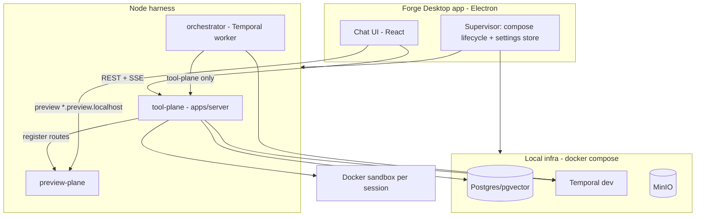

# RFC 0001: Forge Harness Extraction

- **Status:** Accepted
- **Date:** 2026-08-25
- **Authors:** Forge contributors

## Summary

Extract a **chat-only, locally runnable coding-agent harness** named **Forge** into a new Apache-2.0 open-source repository. Forge packages the chat UI, tool-plane server, Temporal orchestrator, Docker sandbox runtime, and local preview proxy into a product that developers can run on their own machines—optionally wrapped in an Electron desktop app that supervises docker-compose and Node processes.

This RFC records the extraction decisions, keep/drop boundaries, target architecture, and the major rework items required to turn the Forge Agent monorepo slice into a clean public project.

## Motivation

The upstream product combines an interactive coding agent (chat + sandboxed tools + preview) with product surfaces that are not required for a self-hosted harness: board/kanban, documents, SDLC pipeline UI, cloud IaC, and multi-tenant SaaS auth.

Open-sourcing the full product would force contributors and users through unrelated infrastructure and product concepts. A focused extraction:

- Makes the coding-agent loop understandable and hackable.
- Runs entirely on a laptop with Docker and Node.
- Avoids shipping proprietary or cloud-only coupling.
- Gives Forge a clear license and identity (Apache-2.0).

## Goals

1. Ship a **chat-only** harness: connect a repo, chat with an agent, run tools in a Docker sandbox, preview the app locally.
2. Be **locally runnable** via docker-compose (Postgres, Temporal, MinIO) plus Node processes for server, orchestrator, preview-plane, and web UI.
3. Provide an **Electron desktop** path that supervises compose + processes and opens the chat UI in Chromium.
4. Let users supply **LLM keys** through an in-app Settings UI (no mandatory `.env` editing for end users).
5. Support **local folder** and **git clone** as repo sources (no GitHub OAuth in v1).
6. Keep the **preview-plane** for `*.preview.localhost`.
7. License the repo under **Apache-2.0**.

## Non-goals (v1)

- Multi-tenant SaaS auth, org billing, or hosted cloud control plane.
- Board/kanban, tickets, documents, or full SDLC pipeline UX.
- EKS / OpenTofu / Helm production deployment for Forge itself.
- GitHub OAuth or marketplace integrations.
- Mobile clients.

## Architecture

### Planes and roles

| Component | Role |
| --------- | ---- |
| **tool-plane (`apps/server`)** | HTTP API for chats, models, session/sandbox lifecycle, and tool execution. Owns Docker sandbox adapters and preview route registration. |
| **orchestrator (`packages/orchestrator`)** | Temporal worker that drives the interactive chat turn: LLM calls, tool planning, and tool-plane invocations. Talks to tool-plane only—never to preview-plane for tool exec. |
| **preview-plane (`apps/preview-plane`)** | Local reverse proxy for session preview hosts (`*.preview.localhost`). |
| **Docker sandbox** | Isolated per-session workspace where the agent runs shell/file tools and (optionally) a dev server. |
| **web-ui (`apps/web-ui`)** | Chat workbench: composer, tool call display, model/mode pickers, Settings, Connect repo. |
| **Electron desktop (`apps/electron`)** | Supervisor: Docker detection, compose up/down, sandbox image build, spawn Node processes, inject loopback auth token, open Chromium. See [RFC 0002](./0002-local-desktop-runtime.md). |

### Deployable mental model

- Browsers / the desktop webview hit the tool-plane for API traffic and the preview-plane for app bytes.
- Orchestrator → tool-plane only.
- Session workspaces stay isolated; teardown removes workspace state and preview routes.

## Decisions

| Decision | Choice | Rationale |
| -------- | ------ | --------- |
| Repository | New clean public repo (no git history from upstream) | Clear license boundary; no accidental proprietary history or secrets. |
| Desktop | Electron + docker-compose supervisor | Native folder pickers, process supervision, and official Chromium DevTools for preview; compose already defines local infra. |
| Product scope | Chat-only | Smallest useful coding-agent loop; defer board/pipeline to other products. |
| LLM credentials | Settings UI → `~/.forge/config.json` (and optional OS secure store) | End users should not edit `.env`; contributors still can for headless/dev. |
| Repo connection | Local folder bind-mount **or** git clone (URL + optional token) | Covers the two common workflows without OAuth in v1. |
| Preview | Keep preview-plane on `*.preview.localhost` | Proven local preview path; no cloud DNS required. |
| License / name | Apache-2.0 / **Forge** | Permissive OSS; distinct product identity. |

## Keep vs drop

### Keep

- `apps/web-ui` — chat workbench routes and components (`chat-workbench`, chat composer, tool display, model/mode pickers). Strip non-chat product routes.
- `apps/server` — chat and models APIs, internal session/sandbox/tools routes, Docker sandbox runtime, preview client, tool implementations.
- `apps/preview-plane` — local preview proxy.
- `packages/orchestrator` — `interactiveChatTurnWorkflow` and chat activities / model resolution.
- `packages/core`, `packages/db`, `packages/tools`, `packages/agents` (chat agent modes), `packages/skills`.
- `docker-compose.yml`, `Dockerfile.sandbox`, trimmed `.env.example`.

### Drop (from the Forge surface)

- Cloud IaC and deploy pipelines (`infra/opentofu`, `infra/helm`, EKS deploy workflows).
- Kubernetes sandbox adapter (Docker-only for local Forge).
- Atlassian and other SaaS integrations.
- Board / kanban / tickets / documents UI and routers.
- Pipeline / persona workflows not required for interactive chat.
- SpecKit product specs from the upstream monorepo (Forge uses RFCs under `docs/rfcs/` instead).
- Unused shared UI packages that the chat shell does not need for v1 packaging (revisit if the web-ui is later refactored onto shared atoms).

## Key rework

### 1. Workspace model

Upstream chats are project-scoped. Forge flattens that to a lightweight **workspace**: one connected local folder or git clone, containing chat sessions. See [RFC 0003](./0003-workspace-and-repo-connection.md).

DB target shape (conceptual): `users`, `workspaces`, `session_messages`, `chat_turns`, `chat_turn_chunks`, `chat_attachments`. Drop board, documents, and GitHub-account tables that only serve the larger product.

### 2. Repo connection

Session sandbox materialization must accept:

- **Local path** — bind-mount the user's folder into the sandbox.
- **Git clone** — clone URL (optional token) into the session workspace.

Desktop exposes Connect repo via native folder picker or URL form. No GitHub OAuth in v1.

### 3. Auth

Replace shared POC bearer + email header UX with a **supervisor-generated loopback token**:

- Bound to `127.0.0.1`.
- Injected into server and webview at startup.
- Single implicit local user.

### 4. Settings

In-app Settings for provider, model, base URL, and API key. Supervisor materializes values into env for server and orchestrator (`OPENAI_API_KEY`, `ANTHROPIC_API_KEY`, `OPENAI_COMPATIBLE_*`, and Forge-prefixed aliases after rebrand).

### 5. Desktop supervisor

`apps/electron` owns Docker preflight, `docker compose up`, sandbox image build, spawning server + orchestrator (+ preview-plane), token injection, and Chromium load. Details in [RFC 0002](./0002-local-desktop-runtime.md).

### 6. Rebrand

Rename scopes and artifacts for the public project:

- `@forge/*` → `@forge/*`
- `PULSE_*` → `FORGE_*` (keep cheap back-compat aliases where useful during transition)
- Docker images `pulse-*` → `forge-*`

## Suggested sequencing

1. Scaffold the Forge repo and clean-copy kept paths.
2. Trim server routers and DB schema to chat-only; introduce workspaces.
3. Trim orchestrator to interactive chat workflow only.
4. Strip web-ui to the chat workbench; add Settings and Connect-repo screens.
5. Add local-folder materialization to the sandbox.
6. Build the Electron supervisor.
7. Rebrand packages/env/images; docs, license, CI, release artifacts.
8. Verify with `pnpm typecheck`, `pnpm build`, `pnpm lint`, `pnpm test`, then an end-to-end desktop launch.

## Open notes

- MinIO is used for uploaded object storage; if chat-only mode drops uploads, MinIO may be removed later to slim infra.
- Web tools remain off by default.
- Contributor workflow for design changes: propose or update RFCs under `docs/rfcs/` before large architectural shifts.

## Alternatives considered

| Alternative | Why not |
| ----------- | ------- |
| Open-source the full upstream monorepo | Too much product and cloud surface; poor onboarding. |
| Tauri instead of Electron | Initially preferred for a thin webview; Electron was chosen so preview can be real Chromium plus official DevTools. |
| CLI-only (no desktop) | Valid for contributors; desktop remains the primary end-user path. Headless `pnpm` + compose stays supported. |
| GitHub OAuth in v1 | Delays launch; local folder + clone covers core needs. |

## References

- [RFC 0002: Local Desktop Runtime](./0002-local-desktop-runtime.md)
- [RFC 0003: Workspace and Repo Connection](./0003-workspace-and-repo-connection.md)
- [RFC index](./README.md)
