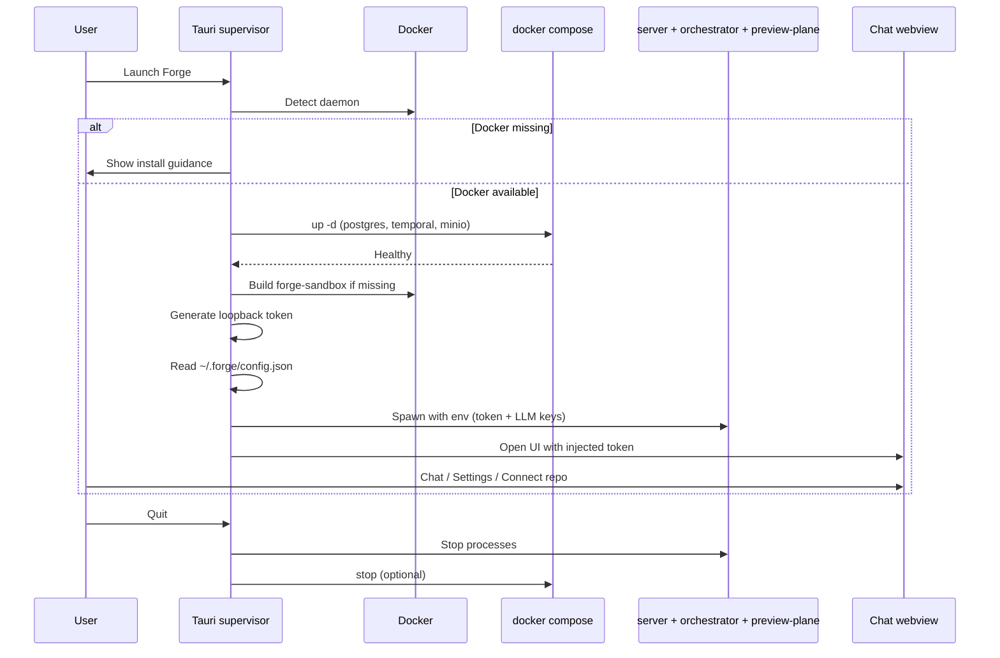

# RFC 0002: Local Desktop Runtime

- **Status:** Accepted
- **Date:** 2026-08-25
- **Authors:** Forge contributors
- **Depends on:** [RFC 0001](./0001-harness-extraction.md)

## Summary

Forge ships a **Tauri desktop app** whose Rust supervisor owns local infrastructure lifecycle: detect Docker, bring up docker-compose services, ensure the sandbox image exists, spawn the Node harness processes, inject a loopback auth token, and open the chat UI in a webview. LLM credentials and preferences live in `~/.forge/config.json`. Previews use the local preview-plane at `*.preview.localhost`.

## Motivation

End users should not manually orchestrate Postgres, Temporal, MinIO, a sandbox image build, three Node processes, and env wiring. Contributors can still run the same stack headlessly with compose + `pnpm`. The desktop app is the packaged path that makes Forge feel like a local product rather than a monorepo checklist.

## Goals

1. One-click (or one-command) local boot of the full harness.
2. Clear failure when Docker is missing or unhealthy.
3. Persist LLM settings outside the repo tree.
4. Shut down cleanly without leaving orphan Node processes.
5. Serve session previews on `*.preview.localhost` without cloud DNS.

## Non-goals

- Managing remote/cloud clusters from the desktop app.
- Multi-user desktop sessions on one machine.
- Replacing docker-compose with a custom container runtime in v1.

## Architecture



## Boot sequence

On launch, the supervisor performs these steps in order:

1. **Detect Docker**  
   Probe the Docker CLI/daemon. If unavailable, show actionable guidance (install Docker Desktop or a compatible engine) and do not proceed.

2. **Compose up**  
   Run `docker compose up -d` for local infra:
   - **Postgres** (pgvector) — chat and workspace persistence
   - **Temporal** (dev server) — chat turn workflows
   - **MinIO** — object store for uploads when enabled  

   Wait for health checks (especially Postgres) before continuing.

3. **Build `forge-sandbox`**  
   If the sandbox image is missing or stale relative to bundled `Dockerfile.sandbox`, build `forge-sandbox:latest` (or the configured tag).

4. **Spawn harness processes**  
   Start:
   - tool-plane server (`apps/server`)
   - Temporal orchestrator worker
   - preview-plane  

   Use bundled Node or the developer toolchain (`tsx` / `pnpm`) depending on packaging mode.

5. **Inject loopback token**  
   Generate a random bearer token for this session. Bind the server to `127.0.0.1`. Pass the token to:
   - server / orchestrator env (e.g. `FORGE_POC_TOKEN` / compatibility aliases)
   - webview bootstrap (equivalent of `VITE_*` token injection)  

   Use a single implicit local user—no email header UX.

6. **Open webview**  
   Load the chat UI once the tool-plane health endpoint responds.

## Configuration: `~/.forge/config.json`

User-facing LLM and preference settings are stored under the user's home directory, not in the git checkout.

Example shape:

```json
{
  "llm": {
    "provider": "openai",
    "model": "gpt-4.1",
    "baseUrl": null,
    "apiKey": "sk-..."
  },
  "openaiCompatible": {
    "baseUrl": "http://127.0.0.1:1234/v1",
    "apiKey": null,
    "model": null
  },
  "desktop": {
    "stopComposeOnQuit": true
  }
}
```

### Behavior

- The **Settings UI** in the webview reads/writes this file through Tauri commands (optionally backed by the OS secure store for the API key field).
- On process spawn, the supervisor **materializes** config into environment variables already understood by server and orchestrator (`OPENAI_API_KEY`, `ANTHROPIC_API_KEY`, `OPENAI_COMPATIBLE_BASE_URL`, etc.).
- Contributors running headless may continue to use `.env` / `.env.example`; desktop users should not need to edit those files.

### File location

| Path | Purpose |
| ---- | ------- |
| `~/.forge/config.json` | Primary settings document |
| `~/.forge/` | Future: logs, cached metadata (optional) |

## Shutdown behavior

On quit (window close or explicit Exit):

1. Stop spawned Node processes (server, orchestrator, preview-plane) gracefully, then force-kill after a short grace period if needed.
2. Optionally run `docker compose stop` when `desktop.stopComposeOnQuit` is true (default **true** for desktop installs; contributors using shared compose may prefer false).
3. Do **not** delete Postgres/MinIO volumes on normal quit—session history should survive restarts.
4. Revoke in-memory loopback token; next launch generates a new one.

Crash recovery: on next launch, detect stale listeners on expected ports, warn the user, and offer to reclaim ports / restart compose services.

## Preview: `*.preview.localhost`

Forge keeps the preview-plane for local app previews:

- Tool-plane registers session preview routes with the preview-plane.
- The UI opens previews at hosts matching `*.preview.localhost` (loopback).
- No public DNS or TLS termination is required for v1 desktop use.
- Orchestrator never calls preview-plane for tool execution; browsers/webview do.

## Packaging notes

- Bundle `docker-compose.yml` and `Dockerfile.sandbox` as app resources (or resolve them from the install layout).
- Release artifacts target macOS, Windows, and Linux via CI (see project README).
- Dev mode: `apps/desktop` can point at a local `pnpm dev` stack for faster iteration while still testing supervisor flows.

## Security considerations

- Server listens on **loopback only** in desktop mode.
- Token is high-entropy, per-launch, and never written to the repo.
- API keys in `config.json` should use restrictive file permissions; prefer OS secure store where Tauri plugins make that practical.
- Sandbox containers must not mount arbitrary host paths beyond the connected workspace the user explicitly chose.

## Alternatives considered

| Alternative | Why not |
| ----------- | ------- |
| Always leave compose running | Simpler, but surprises users with background containers; make stop-on-quit the default with an opt-out. |
| Embed Postgres/Temporal without Docker | Large maintenance burden; Docker is already a sandbox prerequisite. |
| Store LLM keys only in process env | Lost on restart; Settings would feel broken. |

## References

- [RFC 0001: Harness Extraction](./0001-harness-extraction.md)
- [RFC 0003: Workspace and Repo Connection](./0003-workspace-and-repo-connection.md)
