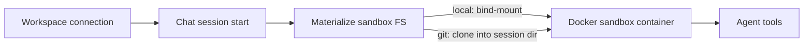

# RFC 0003: Workspace and Repo Connection

- **Status:** Accepted
- **Date:** 2026-08-25
- **Authors:** Forge contributors
- **Depends on:** [RFC 0001](./0001-harness-extraction.md)

## Summary

Forge replaces the upstream **project** (and board-centric) model with a flat **workspace**: a connected **local folder** or a **git clone**. Chats are scoped to a workspace. When a chat session starts, the tool-plane materializes a sandbox by bind-mounting the local path or cloning the remote repository. **GitHub OAuth is out of scope for v1**; clone URLs may include an optional personal access token supplied by the user.

## Motivation

Upstream chat APIs are project-scoped and coexist with boards, documents, and GitHub account linking. For a chat-only local harness those concepts add schema weight and UI without improving the coding loop.

Users of Forge need two things:

1. Point the agent at **code they already have on disk**.
2. Or **clone a remote repo** and chat against that tree.

A single workspace abstraction covers both without multi-tenant project bureaucracy.

## Goals

1. Define **workspace** as the durable container for chats and repo connection metadata.
2. Support connection modes: **local folder** and **git clone**.
3. Materialize a **per-session sandbox** from the workspace connection.
4. Keep chat APIs and UI scoped to `workspaceId` (not board/project product surfaces).
5. Avoid GitHub OAuth and third-party account linking in v1.

## Non-goals

- Multi-repo workspaces (one connection per workspace in v1).
- Automatic PR creation or GitHub App installation.
- Syncing local folder changes through a Forge-managed remote (git remains the user's tool).
- Shared cloud workspaces across machines.

## Concepts

| Term | Definition |
| ---- | ---------- |
| **Workspace** | Named record: display name + connection descriptor (local path **or** git remote). Owns chat sessions. |
| **Connection** | How code enters the sandbox: `local` or `git`. |
| **Chat / session** | Conversation and tool loop scoped to one workspace. |
| **Sandbox materialization** | Preparing the session filesystem inside (or mounted into) the Docker sandbox. |

## Connection modes

### Local folder

- User picks a directory (Electron native dialog in desktop; path entry for headless/dev).
- Workspace stores an absolute host path.
- On session start, the sandbox **bind-mounts** that path (read-write unless a future policy says otherwise).
- The agent edits the user's real files; there is no separate clone copy unless the user chooses git mode.

### Git clone

- User provides a clone URL and optional token (HTTPS) or relies on local SSH agent configuration where Docker networking allows.
- Workspace stores URL + non-secret metadata; tokens should prefer secure storage / env injection over plaintext DB fields.
- On session start, the tool-plane **clones** into the session workspace (or reuses a cached clone under Forge's sessions/repositories root when safe).
- Default behavior matches a disposable or managed session worktree rather than mutating an arbitrary host folder.

## Session sandbox materialization

Materialization lives in the tool-plane session sandbox path (historically `sessionSandbox/materialize` and related Docker runtime adapters).

### Rules

1. Materialize **after** workspace resolution and **before** tools that require a repo root.
2. Local mode: mount the connected path; do not silently copy unless required for isolation policy.
3. Git mode: clone (or refresh) into the session directory; record commit SHA when available for display.
4. Teardown: remove session-specific clones/worktrees and preview routes; **do not** delete the user's local folder in local mode.
5. Reject paths outside allowed roots if a desktop policy allowlist is introduced later; v1 trusts the user's explicit picker choice.

## Chat scoping

- List/create chats under `/api/workspaces/:workspaceId/chats` (or equivalent after rebrand).
- UI: workspace switcher / Connect repo entry point; chat workbench always has an active workspace.
- No board, document, or ticket entities in the Forge schema for v1.

### Suggested schema (conceptual)

- `workspaces` — `id`, `name`, `connection_type` (`local` | `git`), `local_path`, `git_url`, timestamps
- Existing chat tables — foreign key to `workspaces.id` instead of projects
- Drop unused project/board/github-account tables from the Forge migration set

## Auth and tokens (clone only)

- Optional **git credential** for private HTTPS remotes: user-pasted token in Connect flow, stored via desktop secure store or injected env for clone operations.
- **No GitHub OAuth** application, no refresh-token broker, no “connected accounts” settings page in v1.
- SSH remotes may work when the sandbox/host git configuration already has access; documenting that remains a follow-up if Docker isolation blocks the agent socket.

## UI flows

1. **First launch** — empty state: Connect a folder or clone a repository.
2. **Connect folder** — native picker → create workspace → open new chat.
3. **Clone** — URL (+ optional token) → create workspace → materialize on first chat/session.
4. **Switch workspace** — pick another connected workspace; chats do not cross workspaces.

## Security considerations

- Local bind-mounts grant the agent the same filesystem access as the mounted tree—make that explicit in the Connect UI.
- Never mount sensitive host directories by default (home root, `/`, credential dirs).
- Git tokens must not appear in chat logs or tool output.
- Preview routes remain session-scoped and loopback-oriented per [RFC 0002](./0002-local-desktop-runtime.md).

## Alternatives considered

| Alternative | Why not |
| ----------- | ------- |
| Keep full project + board schema | Unnecessary for chat-only; confuses contributors. |
| Always copy local folders into the sandbox | Safer isolation, but breaks “edit my real repo” UX; bind-mount is the v1 default for local mode. |
| GitHub OAuth in v1 | High integration cost; PAT/clone + local folder suffice. |
| Multi-root workspaces | Defer until single-root UX is solid. |

## References

- [RFC 0001: Harness Extraction](./0001-harness-extraction.md)
- [RFC 0002: Local Desktop Runtime](./0002-local-desktop-runtime.md)
