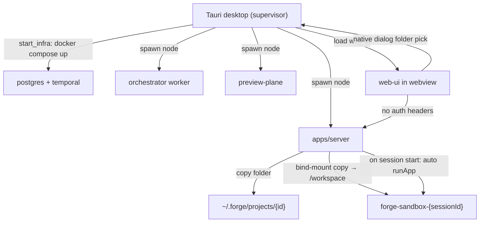

# RFC 0004: Single-User Desktop Forge

- **Status:** Accepted
- **Date:** 2026-08-25
- **Authors:** Forge contributors
- **Depends on:** [RFC 0001](./0001-harness-extraction.md), [RFC 0002](./0002-local-desktop-runtime.md), [RFC 0003](./0003-workspace-and-repo-connection.md)
- **Amends:** RFC 0002 (loopback POC token / email identity), RFC 0003 (ZIP upload + MinIO canonicals)

## Summary

Forge is a **single-user, desktop-first** local product. There is no `FORGE_POC_TOKEN` or user-email identity. Connecting a project uses a native folder picker (browser: absolute-path fallback); the selected tree is **copied** into `~/.forge/projects/{id}/` as the canonical workspace and bind-mounted into the session sandbox. Starting a chat session provisions the sandbox and **auto-starts** web apps from `.forge/launch.json`. The Tauri supervisor boots compose + Node processes and hosts the web UI.

## Motivation

POC bearer auth and email headers were loopback scaffolding, not product requirements for a single local user. ZIP upload into MinIO added operational weight (object store, client-side zipping) when the machine already has the folder on disk. Users expect: pick a project, chat, and see a preview without wiring tokens or MinIO.

## Goals

1. Remove all dependency on `FORGE_POC_TOKEN`, `FORGE_WEB_UI_USER_EMAIL`, and `X-Forge-User-Email`.
2. One implicit local user; keep `userId` columns filled by a singleton DB user to avoid a large schema rewrite.
3. Desktop-first folder select → copy into `~/.forge/projects/{id}/` as canonical; remove ZIP upload and MinIO.
4. Browser remains a fallback: path text input for import; infra started manually via compose + `pnpm`.
5. Auto-run `.forge/launch.json` web apps when a chat session is provisioned/started.
6. Implement the full Tauri supervisor (preflight, start/stop infra, native dialog) loading `@forge/web-ui`.

## Non-goals

- Multi-user auth, OAuth login, or cloud tenancy.
- Rewriting every table to drop `user_id` in this change.
- Replacing Docker sandboxes or Temporal.
- Auto-detecting `package.json` scripts when `launch.json` is absent (scaffold/Run tab remains).

## Architecture

## A. Remove auth and user identity

- Singleton local user via `getLocalUser()` → `getOrCreateUser("local@forge")`, cached. Handlers use this instead of email headers.
- Drop bearer checks in tool-plane (`pocAuth`), internal routes, orchestrator outbound calls, and preview-plane gateway/register.
- Remove env vars: `FORGE_POC_TOKEN`, `VITE_FORGE_POC_TOKEN`, `FORGE_WEB_UI_USER_EMAIL`, `VITE_FORGE_USER_EMAIL`.
- Strip ownership checks that only compared `userId` (single user makes them moot).
- GitHub OAuth state secret: fixed local secret (or dedicated env), not POC token.

This amends RFC 0002’s “generate loopback token / inject into webview” boot step: no token is generated or required.

## B. Folder select and `~/.forge/projects/`

- Default projects root: `~/.forge/projects` (overrideable via env).
- `POST /api/projects` with `{ localPath }` validates an absolute directory, creates the project row, **copies** the tree into `~/.forge/projects/{id}/` (skip `node_modules`, `.git`, `dist`, etc.), sets `source: "local"`, `canonicalKey` to the copy path, `dedupeKey: local:{sourcePath}`.
- Session sandbox: bind-mount the copy at `/workspace` (existing local-folder path). Edits are already canonical; object-store promote is removed.
- **Removed:** `POST /api/projects/upload`, multer ZIP path, MinIO/`OBJECT_STORE_*`, `materializeUploadIntoVolume`, `upload` project source (migration).
- **UI:** Desktop → native folder dialog → `{ localPath }`. Browser → absolute-path input → same API. Hint that native pick needs the desktop app.

## C. Auto-run preview on session start

After `provisionSessionSandbox` succeeds (session start and chat/workbench create), best-effort `autoStartPreview(sessionId)`: for each `type: "web"` app in `.forge/launch.json` that is not running, call `runApp` (port wait + preview publish). Skip silently if no launch config. Run tab polling continues to reflect status.

## D. Tauri desktop supervisor

- Point webview at web-ui (`devUrl` Vite / `frontendDist` web-ui dist); root `desktop` script.
- Plugins: dialog, fs, shell; `pick_folder` / frontend dialog API.
- Implement `preflight_docker`, `start_infra` (compose postgres+temporal, sandbox image, spawn server/orchestrator/preview-plane with keys from `~/.forge/config.json`), `stop_infra` on quit.
- Web-ui bridge: `isDesktop()` / `pickFolder()` with lazy Tauri imports so browser builds work.

## Product stance

**Desktop-first, browser as fallback.** Primary path: Tauri (native pick + supervised infra). Browser path: same UI, path-input import, manual `docker compose` + `pnpm dev`.

## Compatibility / migration

- Existing `upload` projects and MinIO objects are out of scope for automatic migration; operators re-connect via folder select.
- Docs and `.env.example` drop token/email/object-store settings; compose drops MinIO.

## Verification

1. Boot without `FORGE_POC_TOKEN` / user email env.
2. Desktop: pick folder → `~/.forge/projects/{id}` populated → chat session provisions sandbox and starts web preview when launch.json exists.
3. Browser: absolute path import works; build succeeds without Tauri runtime.
4. No `Authorization` / `X-Forge-User-Email` on API traffic; preview-plane open locally.

## Open questions

None for v1 of this RFC; follow-ups may drop `user_id` columns or add launch.json auto-scaffold on session start.
