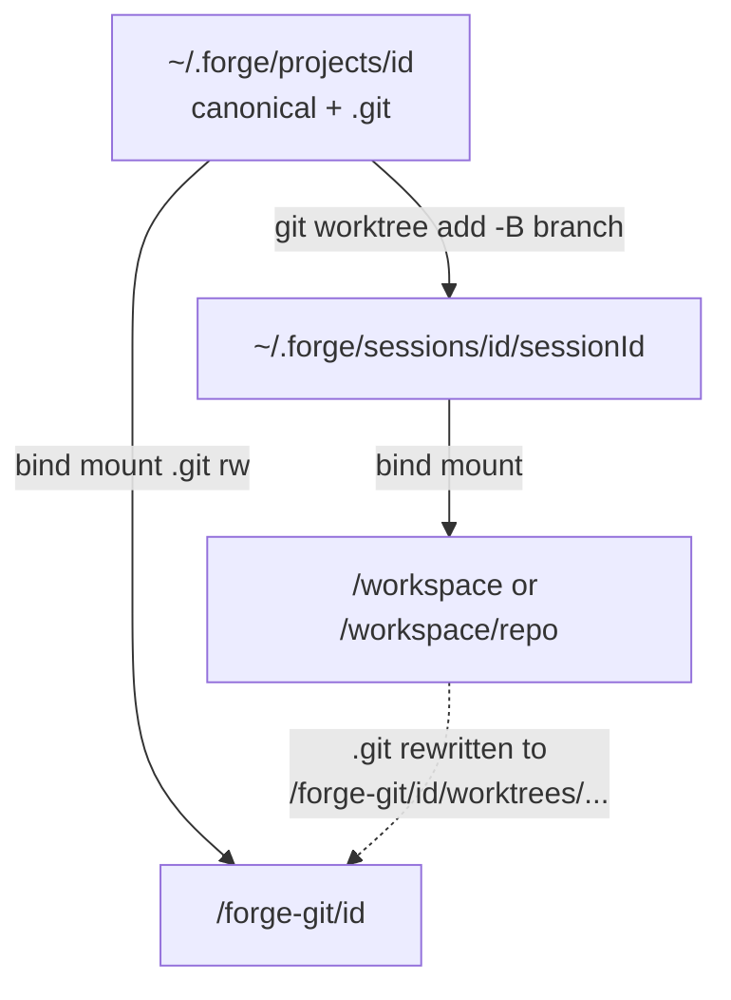

# RFC 0005: Local Session Git Worktrees

- **Status:** Draft
- **Date:** 2026-08-27
- **Authors:** Forge contributors
- **Depends on:** [RFC 0001](./0001-harness-extraction.md), [RFC 0003](./0003-workspace-and-repo-connection.md), [RFC 0004](./0004-single-user-desktop-forge.md)
- **Amends:** RFC 0003 (local folder bind-mount of the connection path), RFC 0004 (bind-mount of `~/.forge/projects/{id}/` into every session)

## Summary

Local projects keep a real `.git` under `~/.forge/projects/{id}/`. Each chat session gets a **per-session git worktree** (and branch, reusing `chat.branchName`) under `~/.forge/sessions/{projectId}/{sessionId}/`. The sandbox bind-mounts that worktree at `/workspace` (or `/workspace/{repoName}` for workspace members) and bind-mounts the canonical `.git` at `/forge-git/{projectId}`. The worktree’s forward `.git` pointer is **rewritten** to that container path so in-container git works while object storage stays shared.

## Motivation

RFC 0004 copies a selected folder into `~/.forge/projects/{id}/` and bind-mounts that copy into every session. Edits in a project chat (including `.forge/launch.json`) therefore appear in every workspace chat that includes the same local project. GitHub sessions already isolate via per-session clone + branch. Local projects need the same isolation without paying full clone disk cost per session.

Today `copyProjectTree` also **skips `.git`**, so the canonical copy is not a repo: in-container `git checkout -B` is a no-op, and local `promoteToCanonical` is a no-op.

## Goals

1. Preserve (or initialize) `.git` in the canonical local project copy.
2. Give each chat session its own working tree for each local project it uses.
3. Keep disk cost low by sharing the canonical object store via git worktrees.
4. Make in-container git (`status`, `commit`, tools, promote) work against `/workspace`.
5. Make local `promoteToCanonical` a real merge into the canonical default branch.
6. Support workspace-scoped sessions: one worktree per member project, not one at `/workspace` root.

## Non-goals

- Overlay FS / copy-on-write isolation.
- Auto-promote on chat close.
- Changing the GitHub clone-into-volume flow.
- Rewriting submodule gitdir pointers.
- Multi-user locking or concurrent `gc` policies for the shared object store.

## Concepts

| Term | Definition |
| ---- | ---------- |
| **Canonical repo** | `~/.forge/projects/{id}/` — durable Forge copy with a real `.git`. |
| **Session worktree** | `~/.forge/sessions/{projectId}/{sessionId}/` — working files for one chat; `.git` is a file pointing at the shared gitdir. |
| **Gitdir rewrite** | After `git worktree add`, replace the host absolute path in the worktree’s `.git` file with `/forge-git/{projectId}/worktrees/{adminName}`. |
| **`/forge-git/{projectId}`** | Container path where the canonical `.git` is bind-mounted (read-write). |
| **Promote (local)** | Commit in-container on the session branch, then merge that branch into the canonical default branch on the host. |

## Architecture

### Project-scoped session mounts

| Host | Container |
| ---- | --------- |
| `~/.forge/sessions/{projectId}/{sessionId}/` | `/workspace` |
| `~/.forge/projects/{projectId}/.git` | `/forge-git/{projectId}` |

### Workspace-scoped session mounts (per local member)

| Host | Container |
| ---- | --------- |
| `~/.forge/sessions/{memberProjectId}/{sessionId}/` | `/workspace/{repoName}` |
| `~/.forge/projects/{memberProjectId}/.git` | `/forge-git/{memberProjectId}` |

GitHub members continue to clone into the session volume; unchanged.

## Connect path

1. Stop skipping `.git` in `copyProjectTree` (still skip `node_modules`, build caches, etc.).
2. After copy, `ensureCanonicalGitRepo(dest)`: if no `.git`, `git init`, set identity, `git add -A`, `git commit -m "forge: initial import"` (skip commit if empty).
3. Existing projects without `.git` get the same lazy init on first provision.

## Provision / destroy / promote

### Provision

1. `assertSafeBranch(chat.branchName)`.
2. `ensureSessionWorktree({ canonicalKey, projectId, sessionId, branchName })`:
   - `git -C canonical worktree add -B branch <workDir>` (reuse if present).
   - Resolve admin dir via `git worktree list --porcelain`.
   - Rewrite `<workDir>/.git` → `gitdir: /forge-git/{projectId}/worktrees/{adminName}`.
   - Configure `core.fileMode false` while the host pointer is still valid.
3. Create the sandbox with both bind mounts (worktree + canonical `.git`).
4. Drop the previous direct bind of `canonicalKey` and the ineffective in-container `git checkout -B` for local workspace members.

### Destroy

Best-effort: `rm -rf` the session worktree dir, then `git -C canonical worktree prune`. Do not fail session destroy on prune errors.

### Promote (local)

1. In-container: `git add -A && git commit` on the session branch (objects land in shared `.git`).
2. On host: `git -C canonical merge --ff-only {branchName}` (fall back to a normal merge).
3. Workspace-scoped promote remains unsupported.

Host-side git always uses the canonical main worktree. After the pointer rewrite, the session worktree is valid only inside the container.

## Alternatives considered

| Option | Outcome |
| ------ | ------- |
| Keep shared bind; only restore `.git` | Git works; **no session isolation**. Rejected. |
| Extra mounts of the host absolute gitdir path (option A) | Works but machine-specific and awkward inside Docker. Rejected. |
| `git clone --local` per session | Isolates and has a self-contained `.git`; more disk than worktrees. Deferred as fallback. |
| Overlay FS | Out of scope. |

## Migration

- Next provision runs `ensureCanonicalGitRepo` for existing local projects.
- Changing the `/workspace` host path recreates the container (existing bind-path detection).
- Uncommitted files that only lived on the old shared mount do not appear in new worktrees until committed on canonical or promoted from a session.

## Open questions

1. Should session branches be deleted on destroy, or left for history/promote?
2. Promote conflict UX when `--ff-only` fails (surface merge error vs force merge).
3. Submodule gitdir pointers for repos with `.gitmodules` (out of scope for v1).

## Verification

1. Connect a local folder that is a git repo → `~/.forge/projects/{id}/.git` exists.
2. Connect a folder without git → Forge initializes a repo with an initial commit.
3. Two chats on the same local project do not see each other’s uncommitted edits.
4. Workspace chat with two local members mounts two worktrees + two `/forge-git/{id}` paths.
5. In-container `git status` / commit succeeds.
6. Local promote merges the session branch into canonical `main` (or default).
