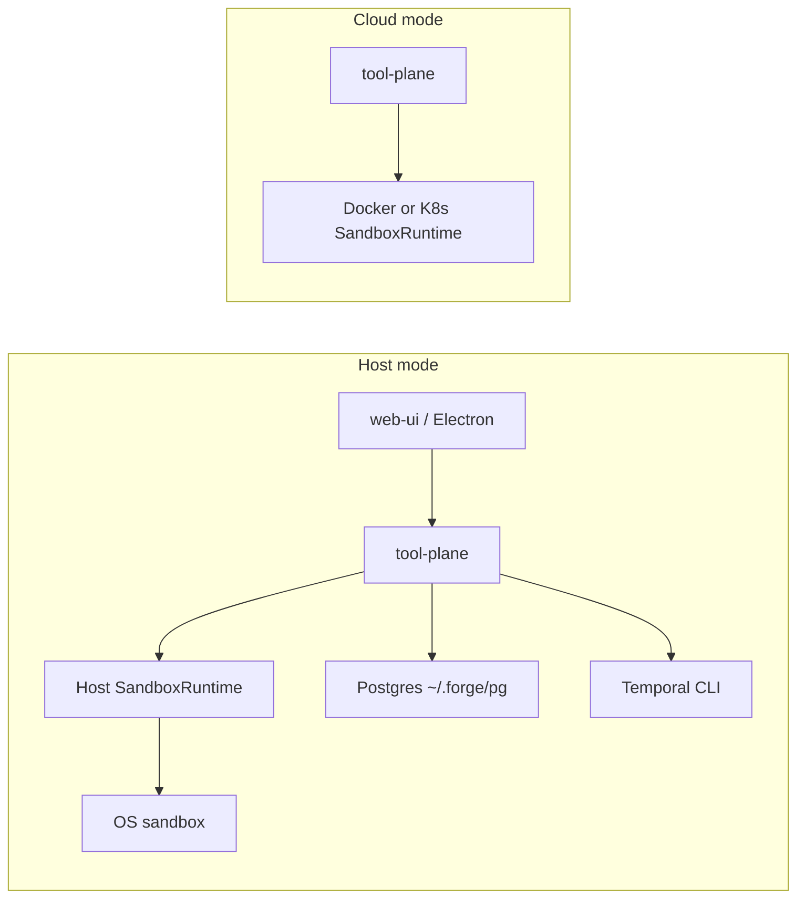

# RFC 0006: Local Host Runtime and Zero-Docker Desktop

- **Status:** Draft
- **Date:** 2026-09-07
- **Authors:** Forge contributors
- **Depends on:** [RFC 0001](./0001-harness-extraction.md), [RFC 0002](./0002-local-desktop-runtime.md), [RFC 0005](./0005-local-session-git-worktrees.md)
- **Amends:** RFC 0001 (Docker as the only local sandbox), RFC 0002 (compose/Docker as desktop boot prerequisite)

## Summary

Phase 1 introduces **host mode**: local Forge runs session tools, previews, and catalog infra **without a Docker daemon**. Sessions use a host-process `SandboxRuntime` with a light OS sandbox (Seatbelt / bubblewrap / WSL2+bwrap), per-session git worktrees, a port registry, and native Postgres + Temporal under `~/.forge/`.

**Cloud mode** keeps the existing Docker and Kubernetes adapters. Docker Sandboxes (`sbx` microVMs) and multi-tenant hardening (gVisor / Firecracker) are out of scope for this phase.

## Motivation

Docker Desktop + per-session containers isolate well but cost substantial RAM on developer machines. Peer local agents (Cursor, Claude Code, Codex CLI) use OS-level process sandboxes on the host. Forge should offer the same class of local experience while retaining container/K8s runtimes for cloud.

Desktop boot today assumes Docker for Postgres, Temporal, the sandbox image, and session exec. That couples “install Forge” to “install and run a container engine,” which is heavier than necessary for single-user desktop.

## Goals

1. `SANDBOX_RUNTIME=host` (default when `FORGE_DESKTOP=1`) runs chats, tools, and previews with **no Docker daemon**.
2. Preserve **multi-session isolation**: separate worktrees, ports, process trees, and OS-sandbox writable roots.
3. Keep the **preview reverse proxy** (`*.preview.localhost`); only drop Docker `-p` / port-repair.
4. Ship a **light OS sandbox** around agent-spawned processes (not around the tool-plane itself).
5. Make the **full agent tool catalog** work in host mode (hybrid in-process FS + sandboxed spawn; host `web_fetch` / `web_search`).
6. Run **Postgres 16** and **Temporal CLI `start-dev`** as supervised host processes under `~/.forge/`.
7. Provide an **Activity** UI for live sessions, ports, and previews.

## Non-goals (this phase)

- Billing, accounts, quotas, or full remote cloud productization.
- Replacing Temporal or switching catalog DB to SQLite/PGlite.
- Docker Sandboxes (`sbx`) / Firecracker / gVisor as the local default.
- Native Windows sandbox without WSL.
- Running in-process file tools inside the OS sandbox by default.

## Vocabulary

| Term           | Meaning                                                                                         |
| -------------- | ----------------------------------------------------------------------------------------------- |
| **Host mode**  | Local runtime: processes on the machine + OS sandbox policy.                                    |
| **Cloud mode** | Docker or Kubernetes `SandboxRuntime` (existing adapters).                                      |
| **Boundary**   | Where isolation is enforced (shared kernel + OS policy for host mode; container/K8s for cloud). |
| **Policy**     | What code may touch (FS allowlist, network, env scrub, resources).                              |
| **Lifecycle**  | Session workspace: idle stop / destroy; not fresh-per-tool-call.                                |

Host mode is **not** a stronger boundary than Docker containers. It trades container isolation for lower memory and desktop simplicity, with OS policy comparable to local coding agents.

## Architecture

### Runtime selection

- `SANDBOX_RUNTIME=host` | `docker` | `kubernetes` (`k8s` alias).
- Default: `FORGE_DESKTOP=1` → `host`; otherwise `docker` unless overridden.
- Cloud deployments keep `docker` / `kubernetes`.

### Path contract

- Tools and agents keep logical `/workspace` (and `/workspace/{repo}`).
- Host adapter maps to session worktrees under `~/.forge/sessions/{projectId}/{sessionId}/` (RFC 0005).
- In-process file tools use mapped absolute paths with a strict allowlist to session roots.

### Preview and ports

- Apps bind `127.0.0.1:{hostPort}` from a **session port registry** (allocate/release; restart-safe).
- Injected `PORT` / service `internalUrl`s use registry ports (no shared `3000` across sessions on one host).
- Preview-plane continues to map `*.preview.localhost` → those backends.
- Drop Docker publish/repair only.

### OS sandbox (host mode)

| Platform | Mechanism                                          |
| -------- | -------------------------------------------------- |
| macOS    | Seatbelt profile                                   |
| Linux    | bubblewrap (`bwrap`)                               |
| Windows  | WSL2 + bwrap; require WSL2 for sandboxed host mode |

Applies to: `exec`, background jobs, `preview_start`, node-pty shells, and sandboxed tool spawns.  
Does not wrap: tool-plane, Temporal worker, Postgres, preview-plane, or in-process file tools (path policy only).  
Escape hatch: `FORGE_HOST_SANDBOX=0` (debug only).

### Agent tools (hybrid)

| Class           | Tools                                                               | Host behavior                                                  |
| --------------- | ------------------------------------------------------------------- | -------------------------------------------------------------- |
| In-process FS   | `read_file`, `write_file`, `edit_file`, `list_*`, `search_codebase` | Host FS + path allowlist                                       |
| Sandboxed spawn | `run_terminal`, PTY, preview jobs                                   | Host adapter under OS sandbox; scrubbed env                    |
| Host web        | `web_fetch`, `web_search`                                           | Host Playwright (or curl); host search workers — **no Docker** |
| Meta            | `docker_image_lookup`                                               | Hidden / unavailable in host mode                              |
| App DB          | `provision_app_engine`                                              | Localhost engines (no `forge` network aliases)                 |

### Zero-Docker catalog infra

- Postgres 16 binary under `~/.forge/pg/` (not PGlite); default `DATABASE_URL` on `127.0.0.1:5433`.
- Temporal: `temporal server start-dev`, data under `~/.forge/temporal/`.
- Electron supervisor: `ensureNativeStack` instead of compose/sandbox image for host-mode boot.

### Activity monitor

Lightweight dialog: active sessions, preview apps, port registry rows; stop session / stop app. No CPU graphs or system-wide process browser in Phase 1.

## Security considerations

- Host mode shares the host kernel; policy leakage (broad mounts, open egress, inherited secrets) is the primary risk.
- Never inherit tool-plane env into agent processes; allowlist only.
- Deny `~/.ssh` and unrelated home paths by default in the OS sandbox profile.
- Reap orphan session process trees on tool-plane startup.
- Port free / kill must be session-scoped (no container `/proc` scanners that can hit another session).

## Alternatives considered

| Alternative                       | Why not (Phase 1)                                                                                               |
| --------------------------------- | --------------------------------------------------------------------------------------------------------------- |
| Docker Sandboxes (`sbx` microVMs) | Stronger boundary, but heavier default RAM; separate product/CLI; revisit for high-isolation cloud/local later. |
| Keep Docker for desktop always    | Defeats memory/UX goal for local.                                                                               |
| PGlite / in-process Temporal      | Larger protocol/migration change; keep `pg` + Temporal CLI.                                                     |
| Host tmux for shells              | Windows gap; dual codepath — use node-pty everywhere in host mode.                                              |
| Wasm-only tool sandbox            | Insufficient for shell + package managers + previews.                                                           |

## Implementation sketch

1. Extend `SandboxRuntimeKind` with `"host"`; resolve defaults; `hostAdapter` + port registry + OS sandbox wrapper.
2. Route `dockerExec` / status / jobs / PTY / tools through the runtime.
3. Host tool model (Workstream 4b in the implementation plan).
4. Native PG + Temporal in Electron supervisor.
5. Activity API + UI; docs and smoke without Docker.

## References

- Implementation plan: local host zero-Docker (workspace plan)
- [RFC 0001: Harness Extraction](./0001-harness-extraction.md)
- [RFC 0002: Local Desktop Runtime](./0002-local-desktop-runtime.md)
- [RFC 0005: Local Session Git Worktrees](./0005-local-session-git-worktrees.md)
- Luis Cardoso, [A field guide to sandboxes for AI](https://www.luiscardoso.dev/blog/sandboxes-for-ai) (boundary / policy / lifecycle framing)
