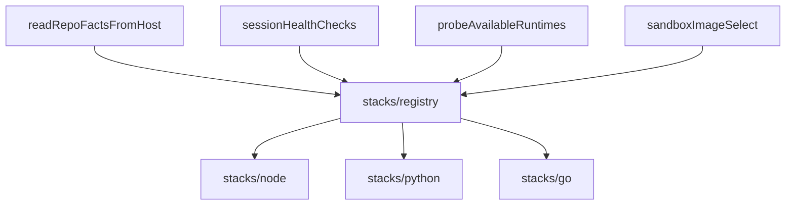

# RFC 0007: Stack Adapters for Multi-Language Workspaces

- **Status:** Accepted
- **Date:** 2026-09-10
- **Authors:** Forge contributors
- **Depends on:** [RFC 0003](./0003-workspace-and-repo-connection.md), [RFC 0006](./0006-local-host-runtime-zero-docker.md)
- **Amends:** ad-hoc Node-centric facts/health assumptions

## Summary

Language-specific detection (manifests, version pins, install gaps, probes, skill suggestions) lives behind a **`StackAdapter`** registry under `apps/server/src/projects/stacks/`. Platform code (repo facts, session health, sandbox image selection) iterates adapters instead of `if (ecosystem === "node")`.

Host session bootstrap (`hostToolchain`) checks **git only**. Language runtimes are health + provision concerns, not create-session gates.

Docker-only Node `node_modules` volume cache lives under `projects/cloud/`.

## Motivation

Forge assumed Node workspaces. Python/Go members and version mismatches (e.g. host Node 26 vs Next 13 needing `<22`) made dump files (`repoFactsEcosystem`, `repoRuntimeVersions`, `runtimeVersionProbe`) and a hardcoded `node` bootstrap check incorrect.

## Goals

1. One adapter per language stack (Node, Python, Go) owning evidence, requirements, tags, skills, install markers, and version probe.
2. Health and facts remain stack-agnostic via `STACK_ADAPTERS`.
3. Preserve type names (`RuntimeRequirement`, `EcosystemEvidence`) for callers.
4. Bootstrap: git only; no stack → health still defaults to requiring `node` on PATH.
5. Group cloud-only deps cache under `projects/cloud/`.

## Non-goals

- Full language toolchain install into `~/.forge/runtime` (see [RFC 0008](./0008-infra-adapter-runtime-install.md)).
- Cloud multi-version sandbox images.
- New npm package for stacks.

## Architecture

### Contract (`StackAdapter`)

- `id` / `hostBinary` split (`python` vs `python3`)
- `skillId` nullable (Go has none)
- `collectEvidence`, `detectRequirement`, `detectStackTags`, `suggestSkills`, `installGap`, `probe`, `matchesFacts(StackFactsView)`
- Optional `install` facet (RFC 0008)

### Deleted dumps

`repoFactsEcosystem.ts`, `repoRuntimeVersions.ts`, `runtimeVersionProbe.ts` — logic moved into adapters + registry.

## Consequences

- Adding a language = new adapter + registry entry.
- Session create no longer fails solely for missing Node.
- Agent still needs a real install path for mismatched Node (RFC 0008).
