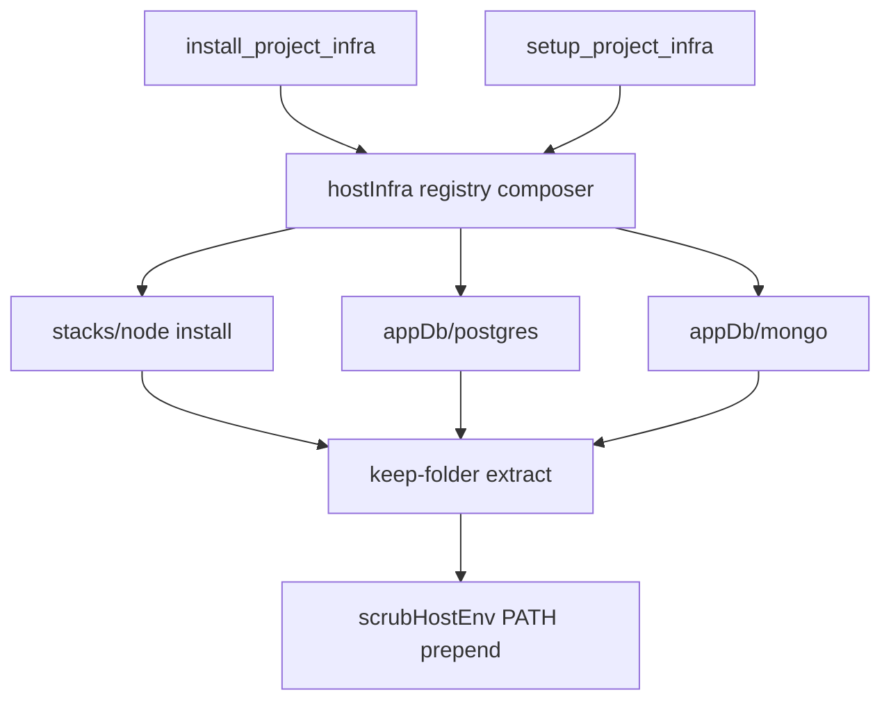

# RFC 0008: Infra Adapters and Keep-Folder Runtime Install

- **Status:** Accepted
- **Date:** 2026-09-10
- **Authors:** Forge contributors
- **Depends on:** [RFC 0006](./0006-local-host-runtime-zero-docker.md), [RFC 0007](./0007-stack-adapters.md)
- **Amends:** hardcoded `hostInfra/registry` + `appDb/engines` allowlists; flat `~/.forge/runtime/bin` cherry-pick

## Summary

`install_project_infra` / `setup_project_infra` remain the only agent-facing install/setup tools. Capabilities come from **adapters**, not a flat dump:

| Tool                    | Responds when                                               |
| ----------------------- | ----------------------------------------------------------- |
| `install_project_infra` | Adapter has an **install** facet (Node, mongo, postgres, …) |
| `setup_project_infra`   | Adapter has a **setup** facet (postgres, mongo — services)  |

**Keep the folder:** every install extracts to `~/.forge/runtime/<dep>/<version>/` with layout intact; `current` symlink; session PATH prefers `…/current/bin` via the host sandbox env (one injection point).

## Motivation

Skills told the agent to put Node in `~/.forge/runtime`, but only mongo/postgres were installable. Agents invented `dependencyId=node-20` or used `run_terminal`. Flat `runtime/bin` linking also breaks Node’s tree (`npm` → `../lib/node_modules`).

## Goals

1. Adapter-owned install facets (stack + DB) composed by `hostInfra/registry`.
2. DB setup facets owned by `appDb/postgres` and `appDb/mongo`; `engines.ts` stays a stable re-export.
3. Uniform keep-folder install; delete basename cherry-pick into flat `bin` as the primary path (legacy flat `bin` remains a discovery fallback).
4. Node: `dependencyId=node` + pinned/coerced `version` (never `node-20`); version-aware reuse; install-only (no setup).
5. One PATH injection: `scrubHostEnv` / `hostProcessEnv` prepends forge runtime bins so terminal, apps, and background jobs (seatbelt/bwrap) see them. Host probe inherits the same PATH via host runtime exec / forge-aware fallback.

## Non-goals

- Cloud multi-version image inject.
- Python/Go portable installers (no install facet until an archive exists).
- Windows zip/msi installers.
- Renaming tools to `install_project_toolchain`.

## Architecture



### Layout

```
~/.forge/runtime/
  node/
    20.20.2/          # intact dist tree
    current -> 20.20.2
  mongo/
    7.0.14/
    current -> 7.0.14
  downloads/
  extract/
  bin/                # legacy fallback only
```

### Version coercion (Node)

Pin table (bumpable): 18 → 18.20.8, 20 → 20.20.2, 22 → 22.20.0. Default major 20. Majors/`20.x`/engines ranges coerce to a pin; exact `x.y.z` passes through.

### Agent contract

- Host Node mismatch → `ask_user` → `install_project_infra dependencyId=node version=20` → re-check health. **Not** `setup_project_infra`. **Not** `run_terminal`.
- DB → install (if missing binaries) → `setup_project_infra`.

## Consequences

- Extending installables = add an adapter facet; tools stay stable.
- Existing flat `runtime/bin` installs still resolve via PATH fallback until users reinstall.
- Cloud sessions still reject host-only installs.
